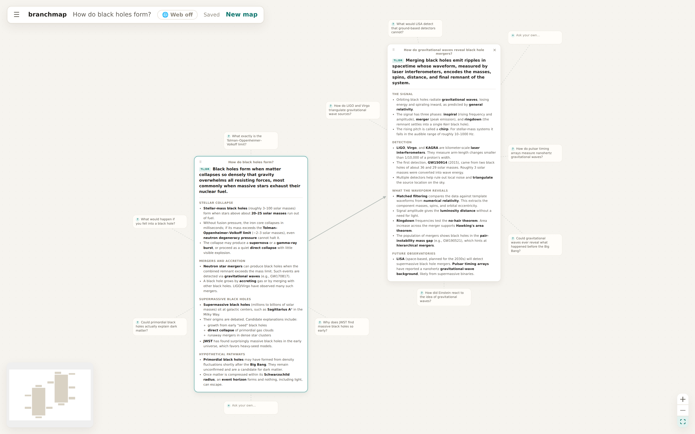

# branchmap

Explore a topic as a mind map. Ask a question and a short, Wikipedia-style answer box appears with a
TL;DR on top. Follow-up questions float around it. Click one, or type your own, to branch off. The
map grows outward from your first question, and every branch remembers the path that led to it.



It runs on your own machine and uses your **Claude subscription** through the
[Claude Agent SDK](https://docs.claude.com/en/docs/agent-sdk/overview) (the logged-in `claude` CLI),
not an API key.

## Features

- **Answer boxes:** each answer streams in as a TL;DR plus a 120–250 word body with short sections.
- **Follow-up chips:** a smaller model suggests 5 follow-up questions around each box. You can drag
  them, dismiss them, or use the "Ask your own…" chip to type your own question.
- **Branch context:** each answer sees only its own branch, meaning the earlier questions and TL;DRs
  plus the box it branched from. Separate branches stay independent.
- **Arrows:** every child box gets an arrow from its parent. Boxes are draggable, and text inside a
  box can be selected and copied.
- **Optional web search:** the 🌐 Web toggle in the top bar lets new questions use web search (and
  only web search). Those boxes get a WEB badge and end with a list of sources. With it off, the model
  answers from what it already knows and has no tools.
- **Saved maps:** maps are stored in SQLite and saved automatically. A ☰ list lets you open, rename
  and delete them, and the open map's ID is in the URL, so you can bookmark it.
- **Light and dark themes** that follow your system setting.

## Requirements

- **Node.js 23.4+:** the app uses the built-in `node:sqlite`.
- **Claude Code CLI:** installed and logged in with a Claude subscription (`claude`, then `/login`).

## Run it

```bash
npm install
npm run dev        # API on :5180, Vite dev server on :5173, open http://localhost:5173
```

Production (one process serves the API and the built app on :5180):

```bash
npm run build
npm start          # http://localhost:5180
```

On macOS you can keep it running in the background as a LaunchAgent. There's a template at
`deploy/com.branchmap.plist.example`. Replace `YOU` with your username, copy it to
`~/Library/LaunchAgents/`, then run `launchctl bootstrap gui/$(id -u) <path>`. Run it as a
LaunchAgent rather than over SSH, because over SSH the login keychain is locked and `claude` looks
logged out.

## Configuration

All settings are environment variables:

| Variable | Default | What it does |
|---|---|---|
| `PORT` | `5180` | API / app port |
| `HOST` | `::` | Bind address. `::` listens on IPv4 and IPv6, so `*.local` names that resolve to IPv6 work. |
| `ANSWER_MODEL` | `claude-opus-5-5` | Model for answer boxes |
| `ANSWER_EFFORT` | `low` | Effort level for answers |
| `FOLLOWUP_MODEL` | `claude-haiku-5-5` | Model for follow-up suggestions |
| `CLAUDE_PATH` | *(bundled CLI)* | Path to the `claude` binary you're logged in with |
| `DB_PATH` | `~/.branchmap/branchmap.db` | Where saved maps are stored |

The server has no authentication. Anyone who can reach the port can read your maps and ask questions
on your subscription, so keep it on localhost or a trusted network.

## How it works

- **Frontend** (`src/`): Vite, React 19 and React Flow.
  - `layout.ts` places chips and new boxes radially without overlaps.
  - `App.tsx` holds the map state and autosave.
  - `Sidebar.tsx` is the map list.
- **Backend** (`server/`): Hono on Node.
  - `llm.ts` calls the Agent SDK with no tools, one turn, no user settings and no saved sessions. Web
    mode adds only the WebSearch tool, pre-approved, with up to 6 turns.
  - `db.ts` stores maps in two tables, `maps` and `nodes`, with each node's data as JSON. Saving
    replaces a map's nodes, and `updated_at` only changes when the content actually changed.
- **API:**
  - `POST /api/answer` streams the answer as server-sent events.
  - `POST /api/followups` returns the follow-up questions.
  - `GET`, `PUT`, `PATCH` and `DELETE` on `/api/maps[/:id]` manage saved maps.

## Ideas

- Collapse and expand branches.
- Export a map or branch as Markdown.
- A "meaningful directions" layout: up for the bigger picture, down for detail, left for origins, right for related topics.
